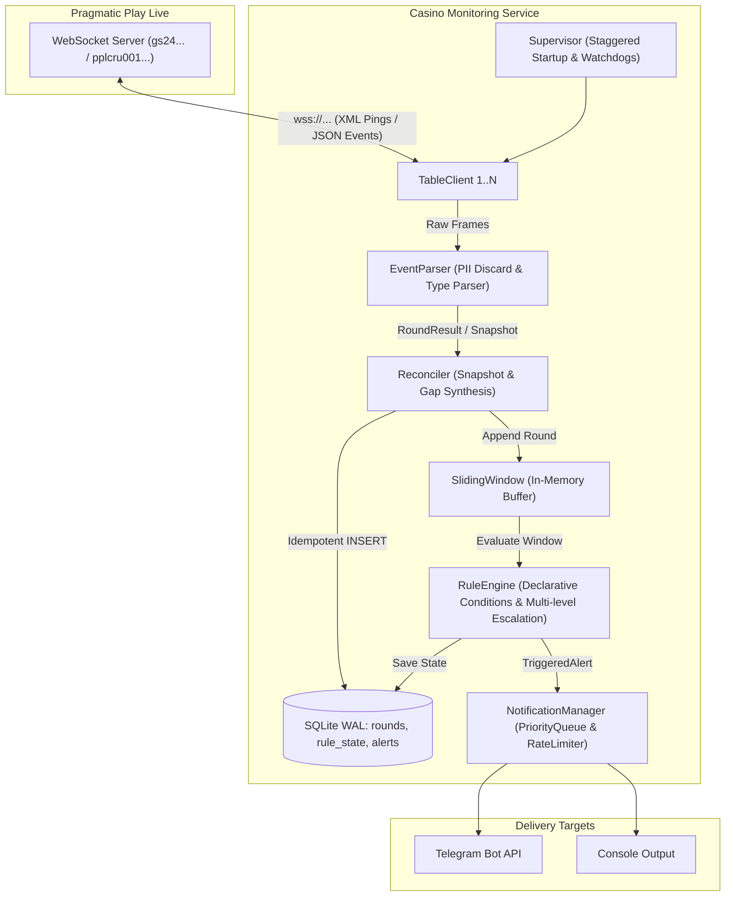

# Pragmatic Play Live Baccarat Real-Time Monitoring Service

Высоконадежный асинхронный сервис на Python 3.12+ (asyncio, WebSockets) для мониторинга в реальном времени столов Pragmatic Play Live Baccarat, декларативной оценки игровых паттернов и правил (стрики, частотности, сигналы) и доставки мгновенных уведомлений в Telegram.

---

## ⚡ Ключевые возможности и архитектурные гарантии

- **Strict Read-Only Guarantee**: Сервис функционирует исключительно в пассивном режиме чтения. Полное отсутствие логики ставок, кликов по интерфейсу ставок или взаимодействия с betting API.
- **Изоляция секретов и безопасность**: Автоматическая маскировка токенов (`JSESSIONID`, Telegram bot tokens, cookie) во всех логах регулярными выражениями (`mask_token`, `MaskingFormatter`). Все секреты и профили браузера изолированы в `.gitignore`.
- **GDPR и защита персональных данных**: События `winners` отбрасываются парсером немедленно в точке входа без чтения или сохранения экранных имен (`screenName`) и идентификаторов игроков (`userId`).
- **Высокая отказоустойчивость**:
  - Heartbeat-пинг каждые 10 секунд по XML-протоколу (`<ping channel="..."/>`).
  - Сторожевой таймер (Silence Watchdog) на 15 секунд отсутствия трафика.
  - Watchdog зависания раундов (отсутствие результатов на столе).
  - Экспоненциальный откат (Exponential Backoff) с джиттером при сбоях сети.
  - Мгновенная реакция на инвалидацию сессии (`<session>offline</session>`) с авто-ротацией токена.
- **Хранение и восстановление (Reconciliation)**:
  - SQLite в режиме WAL (`journal_mode=WAL`) с идемпотентной записью (`UNIQUE(table_id, round_id)`).
  - Скользящее окно раундов (`SlidingWindow`) с настраиваемой политикой учета ничьих (`TIE`).
  - Механизм Reconciliation: при разрыве связи пропущенные раунды автоматически синтезируются из серверного снимка `beadPlate`. При смене башмака (новый `ShoeSummary`) состояние корректно сбрасывается.
- **Гибкий движок правил (Rule Engine)**:
  - Поддержка стриков (Player / Banker / Tie), подсчета исходов в окне, паттернов (чередование, повторы), соотношений (ratio) и логических композиций (`and`, `or`, `not`).
  - Фронт-триггер (срабатывание только на переходе в состояние), многоуровневая эскалация (escalation levels), повторные оповещения (`repeat_every`), уведомления о завершении серии (`notify_on_end`).
  - Реестр плагинов: новые условия добавляются одним декоратором `@register_condition`.
- **Масштабируемость 15+ столов**: Архитектура Supervisor с распределенным запуском (staggered startup), обеспечивающая среднюю задержку обработки события **< 3 мс** (при допустимом лимите 50 мс).

---

## 📐 Архитектура системы



---

## 🚀 Быстрый старт

### 1. Системные требования
- **ОС**: Linux (Ubuntu 22.04+, Fedora 39+, Debian 12+) или macOS.
- **Python**: 3.12 или выше (протестировано на Python 3.14).
- **Playwright Chromium**: для автоматического получения сессий через headless-браузер.

### 2. Установка зависимостей
```bash
git clone <repo-url> casino-monitor
cd casino-monitor

# Установка зависимостей и браузера Playwright
make install
# Либо вручную:
# pip install -e ".[dev]"
# playwright install chromium
```

### 3. Настройка конфигурации и переменных окружения
Скопируйте шаблоны конфигурации:
```bash
cp config.example.yaml config.yaml
cp .env.example .env
```

Отредактируйте файл `.env`:
```env
# Оповещения в Telegram
TELEGRAM_BOT_TOKEN="123456789:ABCdefGHIjklMNOpqrsTUVwxyz"
TELEGRAM_CHAT_ID="-1001234567890"

# Провайдер сессии: "playwright" (рекомендуется) или "env"
SESSION_PROVIDER="playwright"
HEADLESS="true"
BROWSER_PROFILE_DIR="./browser_profile"
```

### 4. Авторизация и получение токенов (разово)
Pragmatic Play Live блокирует сессии без авторизованного аккаунта казино (`ErrorId: 10005: Game unavailable for demo session`).

Выполните команду входа:
```bash
make login
# Или: python3 -m src.cli login
```
1. Откроется окно Chromium. Войдите в свой аккаунт на портале.
2. Перейдите на любой стол Live Baccarat.
3. Скрипт **автоматически перехватит живой токен** `JSESSIONID` и `socket_server` и сохранит их в `.session_cache.json`.
4. Сессия браузера сохранится в `browser_profile/`.

#### Другие способы получения/установки токена:
- **Автоматическое получение в фоне (headless)**:
  ```bash
  make get-token
  # Или: python3 -m src.cli get-token --table bc281koreanch281
  ```
  Скрипт откроет стол в фоновом режиме через сохраненный профиль, получит свежий токен и запишет его в кэш.

- **Ручной ввод (если скопировали токен из DevTools)**:
  ```bash
  python3 -m src.cli set-token --token "uJVEj-i_kZHkarWLtMDhzyprm41LIQ2baS-jmUrx0piT346Pvk4E!746047912-bf1814d9" --server "wss://gs24.pplcru001.net" --table "bc281koreanch281"
  ```

### 5. Проверка отправки уведомлений
Проверьте корректность токена Telegram и Chat ID:
```bash
make test-notify
# Отправит тестовое сообщение в Telegram-канал/чат
```

### 6. Запуск сервиса
```bash
make run
# Или: python3 -m src.cli run
```

---

## 📊 Мониторинг состояния (CLI Status)

В любой момент вы можете просмотреть актуальный статус всех столов в терминале:
```bash
make status
```
Пример вывода:
```text
================================================================================
CASINO MONITOR: SYSTEM STATUS
Database: /path/to/Casino/casino_monitor.db
================================================================================
TABLE ID         | NAME                     | STATUS  | WINDOW | LAST       | AGE | RECONNECTS | ACTIVE STREAK
-----------------+--------------------------+---------+--------+------------+-----+------------+--------------
bc281koreanch281 | Korean Speed Baccarat 1  | ONLINE  | 50     | B (#17952) | 4s  | 0          | 4 (streak_b) 
spto11bctorobc11 | Vietnamese Speed Baccara | ONLINE  | 50     | P (#49210) | 2s  | 1          | -            
================================================================================
```

---

## 🛠 Руководства по настройке и расширению

### Как добавить новый стол для мониторинга
Для подключения нового стола добавьте блок в секцию `tables` файла `config.yaml`:
```yaml
tables:
  - id: "bc281koreanch281"
    name: "Korean Speed Baccarat 1"
    url: "https://bxgnanhldtnm.top/ru/casino/game/68018/speed-baccarat-16-korean"
    enabled: true

  - id: "spto11bctorobc11"
    name: "Vietnamese Speed Baccarat 1"
    url: "https://bxgnanhldtnm.top/ru/casino/game/51523/speed-baccarat-2"
    enabled: true

  # Пример добавления нового стола:
  - id: "speedbaccarat3"
    name: "Speed Baccarat 3"
    url: "https://bxgnanhldtnm.top/ru/casino/game/12345/speed-baccarat-3"
    enabled: true
```
Никакого изменения кода не требуется — Supervisor автоматически подключится ко всем включенным (`enabled: true`) столам с безопасной задержкой старта (`stagger_delay_sec`).

---

### Как настроить правила и условия алертов
Правила настраиваются в секции `rules` файла `config.yaml`.

#### 1. Длинная серия побед (Стрик) с многоуровневой эскалацией:
```yaml
rules:
  - id: "streak_banker_escalation"
    name: "Серия побед Banker"
    enabled: true
    condition:
      type: "streak"
      target: "banker"       # player | banker | tie
      min_length: 5
      tie_policy: "ignore"   # "ignore" (не прерывает стрик) или "break" (прерывает стрик)
    levels:
      - at: 5
        action:
          type: "telegram"
          priority: "normal"
      - at: 8
        action:
          type: "telegram_urgent"
          priority: "urgent"
    rearm: "on_break"
    notify_on_end: true      # Отправить отчет при завершении серии
```

#### 2. Частотность исхода в окне (Count in Window):
Оповещение, если в последних 20 раундах игрок победил 14 или более раз:
```yaml
  - id: "high_player_frequency"
    name: "Доминирование Player"
    enabled: true
    condition:
      type: "count_in_window"
      target: "player"
      window_size: 20
      min_count: 14
      tie_policy: "ignore"
    action:
      type: "telegram"
```

#### 3. Паттерн чередования (Pattern):
Оповещение при чередовании Player-Banker-Player-Banker:
```yaml
  - id: "zigzag_pattern"
    name: "Чередование P-B-P-B"
    enabled: true
    condition:
      type: "pattern"
      sequence: ["player", "banker", "player", "banker"]
      tie_policy: "ignore"
    action:
      type: "telegram"
```

#### 4. Композитные условия (`and`, `or`, `not`):
```yaml
  - id: "composite_rule"
    name: "Стрик Банкира без Ничьих"
    enabled: true
    condition:
      type: "and"
      conditions:
        - type: "streak"
          target: "banker"
          min_length: 4
        - type: "absence"
          target: "tie"
          rounds: 10
    action:
      type: "telegram"
```

---

### Как добавить собственный плагин условия в Python
Все условия используют динамический реестр плагинов. Чтобы создать новое условие:
1. Создайте класс в `src/rules/conditions/` унаследованный от `RuleCondition`.
2. Зарегистрируйте его декоратором `@register_condition("название_типа")`:

```python
from src.rules.base import RuleCondition
from src.rules.registry import register_condition
from src.state.window import SlidingWindow
from src.parser.models import RoundResult

@register_condition("my_custom_condition")
class MyCustomCondition(RuleCondition):
    def __init__(self, target_score: int = 9, **kwargs):
        self.target_score = target_score

    def evaluate(self, window: SlidingWindow, latest_round: RoundResult) -> tuple[bool, float]:
        """Возвращает (is_satisfied, current_metric_value)."""
        is_hit = latest_round.score >= self.target_score
        return is_hit, float(latest_round.score)
```
После этого условие `type: "my_custom_condition"` сразу доступно в `config.yaml`.

---

## 📋 Справочник команд Makefile

| Команда | Описание |
|---|---|
| `make install` | Установка Python-зависимостей и браузера Playwright Chromium |
| `make run` | Запуск параллельного сервиса мониторинга |
| `make status` | Вывод сводной ASCII-таблицы состояния столов в реальном времени |
| `make login` | Запуск браузера с графическим интерфейсом для авторизации и автоперехвата токена |
| `make get-token` | Получение свежего токена в фоне (headless) через сохраненный профиль |
| `make validate-config` | Валидация синтаксиса `config.yaml` и схемы правил |
| `make test-notify` | Отправка тестового алерта в Telegram/Консоль |
| `make replay` | Воспроизведение захваченного потока из HAR-дампа |
| `make test` | Запуск полного набора модульных и интеграционных тестов |
| `make clean` | Удаление кэшей `__pycache__`, `.pytest_cache` и временных файлов |

---

## 🧪 Тестирование и надежность

Проект покрыт исчерпывающим набором тестов:
- **Unit тесты** (`test/unit/`):
  - Маскирование секретов и токенов в логах.
  - Сериализация и валидация конфигурации.
  - Парсинг всех типов сообщений Pragmatic Play Live (`gameresult`, `ShoeSummary`, `statistic`, PII-защита).
  - Скользящее окно и политики обработки ничьих (`ignore`, `break`, `include`).
  - База данных SQLite (WAL, идемпотентность, транзакции).
  - Движок правил: стрики, паттерны, композитные условия, эскалация, сброс башмака, сохранение состояния.
  - Notifier: rate-limiting, приоритетная очередь, обработка Telegram HTTP 429 Retry-After.
- **Интеграционные тесты** (`test/integration/`):
  - Потоковое воспроизведение HAR-сессий с проверкой контрольных сумм раундов.
  - Параллельная работа нескольких столов со staggered-стартом и реконсиляцией.
  - Системный Heartbeat и Watchdog зависания раундов.
  - Тест масштабирования на **15 одновременных столов**: задержка обработки раунда **< 3 мс**.

Запуск всех тестов:
```bash
make test
```

---

## 🔒 Безопасность и соответствие правилам

- Ни при каких обстоятельствах данный сервис не совершает ставок и не модифицирует состояние учетной записи.
- Сессионные куки и ключи доступа никогда не попадают в git-репозиторий и экранируются в логах.
- Персональные данные других игроков (`screenName`, `userId`) безвозвратно уничтожаются при поступлении сетевого пакета.
